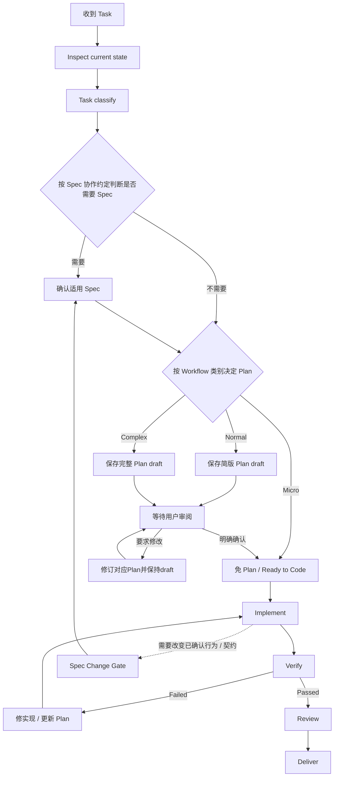

# 人与 AI 的协作执行规范

本规范将仓库任务统一为状态机与四个 Gate。遵守[根规范](../AGENTS.md)；需求和行为约定以
[Spec](spec/README.md) 为准，执行顺序与状态以 [Plan 工作流](exec-plans/README.md) 为准。

## 协作状态机

### Task classify

按影响范围、风险和需求不确定性分类，不按代码行数或预计工时分类；无法确定时升级分类。Plan 是否必需由本表决定；Spec 是否必需独立按[Spec 协作约定](spec/README.md)判断。
| 类别 | 适用条件 | Spec / Plan |
| --- | --- | --- |
| Micro | 单点、局部、低风险；目标和验收明确；不改变已确认行为/契约或安全边界 | 免 Plan；Spec 是否必需按 Spec 协作约定独立判断 |
| Normal | 范围和验收明确，但需要分步实施 | 保存简版 Plan；按 Spec 协作约定判断是否需要 Spec |
| Complex | 跨模块、新契约或数据模型、架构/安全边界变化，或关键需求未决 | 保存完整 Plan；Spec 是否必需按 Spec 协作约定独立判断 |

Micro 的条件不满足或实施中发现影响扩大时，升级为 Normal 或 Complex。Spec 需要时，须先完成 Spec 确认，再保存待审阅 Plan；Complex 需要 Spec 时先确认，再保存完整 Plan。任何已确认行为或契约需要变化时，
无论原分类为何，先过 Spec Change Gate，再更新 Plan 并重新等待用户审阅。

## Plan 审阅 Gate

Codex 原生 Plan 模式只输出方案和预定路径，不写仓库文件。用户同意该方案并切换到实施模式后，Normal/Complex 任务先把最终 Plan 保存为 `draft`，向用户说明保存路径并暂停；这次同意只授权保存 Plan，不授权开始实现。若 Plan 尚有影响范围或行为契约等关键决策未定，先讨论确认，不把假设写成已批准要求。

只有收到用户明确确认，才在 Plan 中记录确认日期和范围，将状态改为 `ready` 并开始实施；沉默、含糊答复或 Plan 状态本身不构成批准。用户要求修改时，更新 Plan 并继续保持 `draft`，再次提交审阅。获批后若目标、范围、契约或关键验收发生实质变化，暂停受影响的实现，更新 Plan 并重新审阅。审阅只授权 Plan 中的范围，不授权其外的工作。

## Ready to Code

开始实现前确认：

- 需求明确；按[Spec 协作约定](spec/README.md)判断需要 Spec 时，适用 Spec 已确认；
- 按分类需要 Plan 时，Plan 已保存、范围/步骤/验收方式匹配，并有明确的用户审阅确认记录，状态为 `ready`；
- 影响实现的关键问题已解决。

Micro 可不创建 Plan，但不能据此推导出免 Spec；Normal 和 Complex 遵循上方分类表。Gate 未通过时先补齐缺失内容，不开始实现。

## Spec Change Gate

任何已确认行为或契约需要改变时：

1. 停止依赖旧约定的实现工作，回到适用 Spec 讨论并记录确认后的行为或契约。
2. 更新 Plan 以反映已确认的范围和步骤，将其恢复为待审阅状态；用户明确确认后再重新检查 Ready to Code。

不得只修改 Plan 来改变已确认要求。若确认后的影响扩大，重新进行 Task classify。

### Implement 阶段的 TDD

适用的产品代码改动在 Implement 阶段按测试优先推进：先新增或修改模块测试，确认测试能暴露缺失行为，再实现代码使测试通过，最后整理实现。测试代码与被测代码一起留在对应模块。纯文档或治理改动不强套 TDD，应按验收点检查文档和相关工具结果。

## 验证与交付

本节定义 Ready to Deliver Gate。只有以下项目都有实际证据后才交付：

- Acceptance Criteria：逐项核对预期结果与实际结果；
- Tests：运行受影响范围的适用测试；
- Lint：运行受影响范围的适用静态检查；
- 必要文档同步：更新受影响的规范、Spec、README、索引或适用的 Skill。

测试或 lint 不适用时，记录原因和相应检查证据，不运行无关检查。失败返回 Implement，修复并更新 Plan（如适用）后重新 Verify；通过后 Review，再 Deliver。
Agent 需要重复执行的验证流程写入适用的 quality Skill；单次实际结果不另建验收文档：Normal/Complex 记入对应 Plan，Micro 写入交付说明。文档变更运行 `python scripts/ci/check-docs.py`，并人工核对内容是否与现状一致。交付说明列出变更结果、检查命令及实际结果、未验证项与原因；必要验证通过并记录后，Plan 归档到同类别 `completed/`。是否建分支、提交或发布遵循用户当前明确指令。

## 文档一致性维护

只同步本次实际受影响的规范、Spec、Plan、README、索引和测试记录。新增、移动或删除可导航文档时更新对应索引并检查链接；历史验证记录保留原结论，当前结果另行记录。文档导航、目录或索引变化后，从仓库根目录运行 `python scripts/ci/check-docs.py`。
