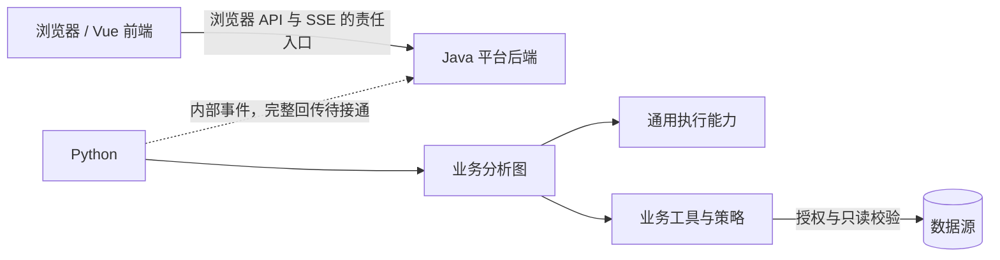

# 系统架构地图

核对日期：2026-10-04。这里提供职责、依赖与代码入口，帮助开发者和 AI 定位任务。
硬性约束以唯一的 [根 AGENTS.md](../../AGENTS.md) 为准；模块实现入口见各模块 README，行为要求与实现状态分别核对。
此图记录当前源码可定位的模块结构与交互入口；连线不证明整条业务链路已端到端接通，缺口见下文。

## 模块与定位

| 模块 | 最终职责 | 已核对的代码和说明入口 |
| --- | --- | --- |
| frontend-web | 页面交互、状态与结果展示 | [路由](../../frontend-web/src/router.ts)、[工作台状态](../../frontend-web/src/lib/workspace-store.ts)、[模块说明](../../frontend-web/README.md) |
| backend-java | 认证、授权、租户与数据集访问、任务入口、审计、浏览器 SSE | [安全配置](../../backend-java/src/main/java/com/dataagent/platform/common/security/SecurityConfig.java)、[数据集服务](../../backend-java/src/main/java/com/dataagent/platform/modules/dataset/service/impl/DatasetServiceImpl.java)、[模块说明](../../backend-java/README.md) |
| backend-agent | 受限上下文内的图编排、模型与工具执行 | [HTTP 入口](../../backend-agent/src/agent_backend/api/http/main.py)、[图构建](../../backend-agent/src/agent_backend/orchestration/data_analysis/graph.py)、[模块说明](../../backend-agent/README.md) |
| infra | 本地依赖与部署配置 | [基础设施说明](../../infra/README.md) |
| scripts | 启动、验证与安全演示辅助 | [脚本说明](../../scripts/README.md)、[文档检查](../../scripts/ci/check-docs.py) |

## 分层与装配

Java 的 `common` 提供跨模块基础设施，`modules/<业务>/` 承载业务控制器、服务接口与
`service/impl` 实现、数据契约和资源访问。控制器依赖服务接口，权限与数据访问由 Java
执行最终校验。模块入口见 [Java README](../../backend-java/README.md)。

Python 的 `api` 是入口适配，`orchestration` 承载图和节点，
`capabilities/agent_runtime` 提供通用执行，`capabilities/data_analysis` 承载业务工具、
Prompt 与节点技能，`foundation` 提供基础契约和底层适配。模型、工具及业务策略在
入口/工厂/图构建处显式装配，通用执行不得暗中导入具体业务。
见 [Python Agent README](../../backend-agent/README.md) 与
[总体架构不变量](../DESIGN.md#2-architectural-invariants)。

前端 `src/pages` 承载页面，`src/components` 承载复用组件，`src/lib` 承载共享类型、
状态与适配。只消费 Java 面向浏览器的接口，权限提示不能替代授权。
见 [前端 README](../../frontend-web/README.md)。

## 数据分析执行与安全

当前图构建可定位到 `load_task_context → build_context → generate_sql → validate_sql
→ execute_sql → interpret_result → build_chart → persist_result`，前置节点拒绝或失败
可进入 `fail_task`；节点实现与测试需逐项确认，不把节点名称当成功能完成证据。
图的详细说明见 [数据分析图入口](../../backend-agent/src/agent_backend/orchestration/data_analysis/README.md)。

Java 下发最小身份与数据范围；Python 不得扩权或重新暴露已屏蔽字段。所有工具执行
须经过 Core Gate，业务工具再检查资源范围与只读 SQL；发现工具不等于授权执行。
契约见 [工具 Spec](../spec/tool-calling/spec.md) 与 [工具设计](../design-docs/cross-module/tool-execution-authorization.md)。
密钥和完整连接信息不得进入提示词、前端、事件、日志、记忆或版本库。

## 已知实现缺口

以下是本次静态核对的现状，不是新增业务待办的授权，也不是端到端测试结果：

- [Java JobController](../../backend-java/src/main/java/com/dataagent/platform/modules/job/JobController.java)
  当前提供 demo 事件；[GatewayController](../../backend-java/src/main/java/com/dataagent/platform/modules/gateway/GatewayController.java)
  提供 health；[AuditController](../../backend-java/src/main/java/com/dataagent/platform/modules/audit/AuditController.java)
  提供 demo 审核状态。不能据此宣称任务投递、浏览器 SSE 与审核流程已接通。
- Python `/internal/tasks` 当前返回 accepted，未在该处理函数内触发分析图；
  [Kafka worker 入口](../../backend-agent/src/agent_backend/api/kafka/worker.py) 当前构建图并打印启动信息，
  尚无该入口的消费循环。完整任务收发链路需要继续实现与验证。
- 前端工作台状态依赖 `mock-data` 与模拟进度，页面中的示例指标和事件不能作为真实分析证据。

## 文档与源码的关系

[总体设计约束](../DESIGN.md) 规定模块设计依据，[详细设计索引](../design-docs/index.md)
定位具体方案与取舍；[架构文档索引](README.md) 区分当前视图与未来目标视图；本文件负责当前已核实的系统地图和实现现状。
[Spec](../spec/README.md) 描述应满足的行为；[Plan](../exec-plans/README.md) 描述本次实施；
可执行测试与代码同放模块，Agent 需要重复执行的验证流程归入适用的 quality Skill，单次实际结果写入 Plan 或交付说明。模块 README、API 和需求等局部文档留在模块内，详细设计正文统一存放在 `docs/design-docs/`；
全局知识统一经 [文档索引](../README.md) 导航。职责或入口变化时更新本地图；
未验证的新能力标明目标状态，不能仅因文档更新就升级为已实现。
